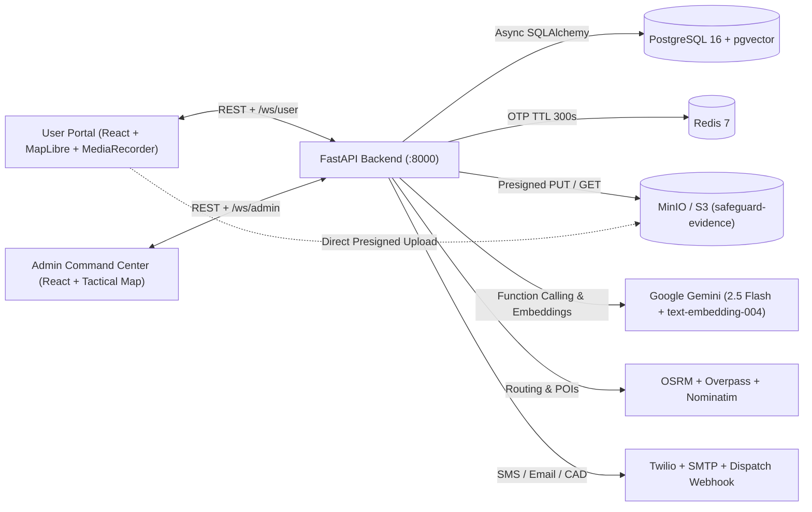

# SafeGuard AI
**Full-Stack Women's Safety, Predictive Routing & Autonomous Emergency Command Platform**

SafeGuard AI combines predictive street-level routing, covert duress protection, tamper-evident chunked audio evidence, an autonomous Gemini 2.5 Flash Guardian Agent, and grounded Indian legal assistance (`BNSS Section 173` & `POSH Act, 2013`) into a real-time dual-portal platform.

---

## Core Features

### User Portal (Women)
- **Passwordless OTP Authentication (`/login`)**: 6-digit cryptographically secure OTP stored in Redis (`300s` TTL) and delivered via SMTP (`aiosmtplib`) or Twilio SMS, followed by a 3-step Safety Onboarding modal (Emergency Contacts, Safe PIN, and Duress PIN stored in PostgreSQL).
- **SafeRoute Predictive Corridor (`/dashboard`)**: Geocodes destinations via OpenStreetMap Nominatim, fetches pedestrian alternatives from OSRM, queries OpenStreetMap Overpass for real `police`, `hospital`, `pharmacy`, and `street_lamp` nodes, and renders `Fastest` vs. `Safest` polylines on a 2.5D MapLibre GL dark map.
- **Tactile Radial SOS Ring & Live Telemetry (`/dashboard`)**: 2-second press-and-hold radial trigger with `navigator.vibrate` haptic feedback, `navigator.geolocation.watchPosition()` live GPS streaming over `/ws/user`, `navigator.getBattery()` monitoring, and real Twilio SMS/WhatsApp emergency contact alerts.
- **Dead-Man's Switch (`/dashboard`)**: Countdown timer that shifts the ambient screen glow to amber below 2 minutes and automatically triggers `DEADMAN_SWITCH` if not disarmed with the Safe PIN.
- **Commute Guardian (`/commute`)**: Live trip monitor with ETA, battery telemetry, and route-deviation evaluation via the AI Guardian Agent.
- **Covert Vault (`/vault`)**: Disguised as a working Calculator (automatically hides the navbar, Emergency Ticker, and Threat Glow). Entering the **Safe PIN + `=`** unlocks the Private Evidence Vault; entering the **Duress PIN + `=`** keeps the calculator normal on-screen while silently triggering `DURESS_PIN`, streaming GPS, and recording 10-second `.webm` audio chunks via `MediaRecorder` hashed with SHA-256 and uploaded to MinIO/S3 via presigned PUT URLs.
- **Grounded Legal RAG & Zero FIR Drafter (`/legal-ai`)**: Pre-LLM immediate-danger guardrail (`CALL 112 / TRIGGER SOS` takeover) + `pgvector` cosine-similarity retrieval over BNSS Section 173 (Zero FIR, e-FIR 3-day signing rule, free FIR copy, SP escalation) and POSH Act, 2013, generating cited guidance and `.txt` / PDF-ready complaint drafts.
- **Global Safety UX**:
  - **Emergency Ticker (`EmergencyTicker.tsx`)**: Sticky rolling 24x7 Indian Govt Helpline marquee (`112`, `1091`, `181`, `1930`, `108`, `15100`), paused on hover and hidden on `/vault`.
  - **Threat-Reactive Ambient Glow (`ThreatGlowWrapper.tsx`)**: Shifts edge vignette across Safe (emerald), Dead-Man's Switch Warning (amber pulse), Active SOS (crimson), and disabled in `/vault`.
  - **`Esc + Esc` Tab-Cloak Panic Hook (`useTabCloak.ts`)**: Double-pressing `Esc` anywhere routes immediately to `/vault`, changes `document.title` to `"Calculator"`, and swaps the favicon while keeping background GPS/WebSockets alive.

### Admin Command Center
- **Login-Only RBAC (`/admin/login`)**: Strict `ADMIN` JWT authentication against PostgreSQL `admins` with no public registration route.
- **Live Tactical War Room (`/admin/command`)**:
  - **Severity-Sorted Alert Queue**: Real-time `/ws/admin` feed prioritizing `CRITICAL - DURESS PIN` and `HIGH - SOS` with battery `<15%` warnings and live elapsed timers.
  - **Full-Bleed MapLibre GL Tactical Map**: Plots live moving GPS breadcrumb trails and real nearby OpenStreetMap police stations via Overpass API.
  - **One-Click Police / PCR Dispatch**: Logs to PostgreSQL `dispatch_logs`, posts to `DISPATCH_WEBHOOK_URL`, updates status (`ACTIVE` → `DISPATCHED` → `RESOLVED`), and suppresses user-facing notifications when `trigger_type == "DURESS_PIN"`.
  - **Synced Audio Evidence Timeline**: Fetches 5-minute presigned GET URLs from `/api/recordings/playback-url` to play incoming 10-second `.webm` chunks.
  - **Collapsible AI Agent Thought Stream Drawer**: Live monospace stream of Gemini 2.5 Flash reasoning steps and tool calls (`query_nearest_safe_havens`, `check_user_telemetry`, `dispatch_emergency_contacts`).
  - **`Ctrl + K` Command Palette**: Keyboard search to jump to any active incident or dispatch immediately.

---

## System Architecture



---

## Tech Stack

| Layer | Technologies |
| :--- | :--- |
| **Frontend** | React 18, TypeScript, Vite, Tailwind CSS, Framer Motion, React Router, Lucide Icons |
| **Backend** | Python, FastAPI, Uvicorn, Async SQLAlchemy, Pydantic, PyJWT, Bcrypt, `aiosmtplib`, `boto3` |
| **AI / ML** | Google `google-genai` SDK (`gemini-2.5-flash` Function Calling, `text-embedding-004` 768-d embeddings) |
| **Geospatial** | MapLibre GL JS, OpenStreetMap Raster Tiles, OSRM Routing API, Overpass API, Nominatim Geocoder |
| **Database & Cache** | PostgreSQL 16 (`pgvector/pgvector:pg16`), Redis 7 (`redis:7-alpine`), MinIO / S3 Object Storage |
| **Realtime & Comms** | Native FastAPI WebSockets (`/ws/user`, `/ws/admin`), Twilio SMS/WhatsApp API, SMTP |

---

## API & WebSocket Reference

| Endpoint / Socket | Auth | Description |
| :--- | :--- | :--- |
| `POST /api/auth/otp/request` | Public | Generates 6-digit OTP in Redis (`EX 300`) and sends via SMTP/Twilio |
| `POST /api/auth/otp/verify` | Public | Verifies OTP, upserts user in PostgreSQL, returns `USER` JWT |
| `POST /api/admin/login` | Public | Authenticates admin against PostgreSQL `admins`, returns `ADMIN` JWT |
| `PUT /api/user/settings` | `USER` | Saves `full_name`, `safe_pin`, `duress_pin`, and `emergency_contacts` |
| `POST /api/incidents/trigger` | `USER` | Creates `SOS` / `DURESS_PIN` / `DEADMAN_SWITCH` / `AI_ANOMALY`, sends Twilio SMS, starts Gemini Guardian |
| `GET /api/admin/incidents` | `ADMIN` | Lists all incidents with user telemetry, dispatches, and recordings |
| `POST /api/admin/incidents/{id}/dispatch` | `ADMIN` | Logs PCR dispatch, sends webhook, suppresses user alert on `DURESS_PIN` |
| `POST /api/saferoute/calculate` | `USER` | Geocodes via Nominatim, fetches OSRM routes, scores via Overpass safe havens & lamps |
| `POST /api/legal/assist` | `USER` | Pre-LLM danger guardrail + `pgvector` cosine search + Gemini Zero FIR drafter |
| `POST /api/recordings/upload-url` | `USER` | Returns 5-min presigned MinIO/S3 PUT URL for 10s `.webm` chunks |
| `POST /api/recordings/confirm` | `USER` | Persists `storage_key` & SHA-256 hash in PostgreSQL, broadcasts `NEW_AUDIO_CHUNK` |
| `GET /api/recordings/playback-url` | `ADMIN` | Returns 5-min presigned MinIO/S3 GET URL for evidence playback |
| `WS /ws/user?token=...` | `USER` | Receives `LOCATION_PING` and delivers `POLICE_DISPATCHED` (non-covert only) |
| `WS /ws/admin?token=...` | `ADMIN` | Streams `NEW_INCIDENT`, `SOS_LOCATION_UPDATE`, `AI_THOUGHT_STREAM`, `NEW_AUDIO_CHUNK`, `POLICE_DISPATCHED` |

---

## Local Setup Guide

### 1. Start Infrastructure (PostgreSQL + pgvector, Redis, MinIO)
```bash
cd safeguard-ai
docker compose up -d
```

### 2. Configure & Run Backend (`:8000`)
```bash
cd backend
cp .env.example .env
# Edit .env with your GEMINI_API_KEY, SMTP_*, TWILIO_*, and JWT_SECRET

python -m venv .venv
# Windows: .venv\Scripts\activate | macOS/Linux: source .venv/bin/activate
pip install -r requirements.txt

# Seed the Command Center Admin (admin@command.local) and pgvector Legal RAG corpus
python seed_admin.py
python seed_legal_rag.py

# Start FastAPI
python -m uvicorn app.main:app --host 0.0.0.0 --port 8000 --reload
```

### 3. Run Frontend (`:5173`)
```bash
cd frontend
npm install
npm run dev
```

Open `http://localhost:5173` in your browser.
